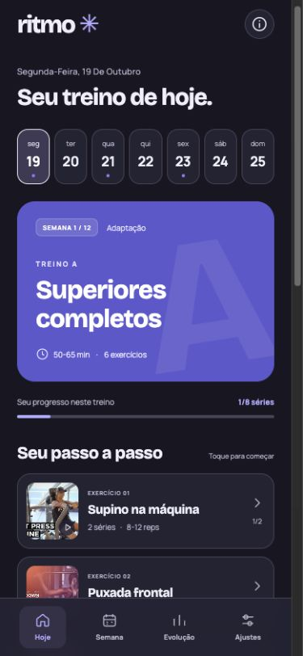

# Ritmo

**Fichas de treino em JSON. Pesquisa aberta. Um aplicativo para levar à academia.**

[Abrir o Ritmo](https://ritmo.mmonteiro.dev) · [Fichas geradas](docs/fichas) · [Pesquisa masculina](docs/pesquisa-masculina.md) · [Fontes](dist/data/sources.json)

O Ritmo transforma perfis de treino em uma agenda para o celular. Você escolhe a ficha, quantos dias vai à academia e quando começa. O aplicativo mostra o treino de hoje, o de amanhã, as demonstrações e as séries que faltam.

O conteúdo é a base do projeto: exercícios, prescrição, calendários, adaptação, orientações e referências ficam em JSONs legíveis e reutilizáveis. A mesma fonte alimenta a interface e gera as fichas de consulta.

## Escolha pelo seu objetivo

| Ficha | Foco | 3 dias | 4 dias | 5 dias |
| --- | --- | --- | --- | --- |
| [Feminina](dist/data/profiles/feminino.json) | Glúteos e composição corporal | A / B / C | A / B / C / B | A / B / cardio / C / B |
| [Masculina](dist/data/profiles/masculino.json) | Hipertrofia geral e proporção | A / B / C | A / B / A / B | A / B / cardio / A / B |

As letras pertencem a cada ficha. Na masculina, A é superiores, B é inferiores e C é corpo inteiro. Na feminina, A e C priorizam inferiores e B trabalha superiores e tronco.

Ambas partem de uma pessoa adulta iniciante, com duas semanas de adaptação e uma base para reavaliar após 12 semanas. Os nomes indicam o foco das fichas; a escolha pode ser feita pelo objetivo. A divisão exata é uma aplicação prática das evidências, não um protocolo validado como conjunto ou uma prescrição individual.

## No celular

- Escolha a ficha no primeiro acesso e altere ficha ou dias em Ajustes.
- Veja hoje, amanhã e as próximas semanas, com recuperação entre os grupos programados.
- Abra demonstrações do exercício e consulte orientações de execução.
- Registre cargas, repetições e séries; acompanhe o histórico de cada perfil separadamente.
- Use os temas claro, escuro ou automático.
- Exporte e importe uma cópia dos perfis, agendas, registros e tema.

Não há conta. Os dados ficam no navegador do aparelho, sem sincronização. Limpar os dados do site remove os registros; exporte uma cópia para guardá-los. Após o primeiro carregamento completo, as fichas podem abrir sem conexão. Vídeos e miniaturas precisam de internet e são servidos pelo YouTube.

<p align="center">
  
  
</p>

## Pesquisa que pode ser conferida

A seleção reúne diretrizes oficiais e estudos de síntese sobre hipertrofia, volume, frequência, recuperação e composição corporal. Cada referência registra o que foi consultado e suas limitações.

- [Fontes e notas de acesso](dist/data/sources.json).
- [Pesquisa masculina estruturada](research/masculino.json) e [relatório de decisões](docs/pesquisa-masculina.md).
- [Ficha feminina gerada](docs/fichas/feminino.md) e [ficha masculina gerada](docs/fichas/masculino.md), com séries, pausas, agendas e volume semanal.
- [Catálogo de exercícios e demonstrações](dist/data/exercises.json), com atribuição e correspondência entre vídeo e variante prescrita.

Mais dias não significam automaticamente mais musculação. Na opção de cinco dias, o dia adicional é aeróbico. Progressão depende de técnica e recuperação; não há promessa de ganho muscular ou perda de gordura em um prazo fixo. Revise a ficha com o profissional da academia.

## JSON como fonte do treino

```text
dist/data/
  profiles.json             catálogo de perfis
  profiles/feminino.json     ficha, agenda, regras e orientações
  profiles/masculino.json    ficha, agenda, regras e orientações
  exercises.json            execução, medidas, grupos e vídeos
  sources.json              referências da pesquisa
research/
  masculino.json            evidência, decisão e limites
docs/fichas/                fichas geradas dos perfis
```

O renderizador não escolhe exercícios pelo nome do perfil. Ele lê as sessões, sequências, complementos e grupos de recuperação declarados no JSON. Novos perfis usam o mesmo motor. Veja o [contrato dos dados](docs/architecture.md) e o [guia de contribuição](CONTRIBUTING.md).

## Rodar e contribuir

Requer Node.js 22 ou superior. Não há dependências de aplicação.

```sh
npm start
npm test
npm run sheets
```

Abra `http://127.0.0.1:43187`. O último comando regenera as fichas e o relatório da pesquisa a partir dos JSONs. Para publicar alterações de conteúdo, revise também as demonstrações, referências e testes.

Código e textos originais sob [licença MIT](LICENSE). As publicações citadas, fontes tipográficas e vídeos mantêm suas próprias licenças. As demonstrações são incorporadas ou vinculadas, sem redistribuição dos arquivos de vídeo.
