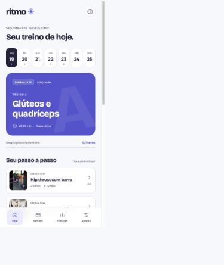

<div align="center">
  
  <h1>Ritmo</h1>
  <p><strong>Seu treino, no seu tempo.</strong></p>
  <p>Treino ABC no celular. Escolha seus dias, veja a execução e acompanhe cada série.</p>
  <p>
    <a href="LICENSE"></a>
    <a href="https://github.com/matheus3301/ritmo/actions/workflows/ci.yml"></a>
    
  </p>
</div>

**[Abrir o Ritmo →](https://ritmo.mmonteiro.dev)**

O Ritmo organiza um plano educativo de academia para uma mulher adulta iniciante, com foco em fortalecimento, hipertrofia de glúteos e apoio ao emagrecimento. A interface foi pensada para consultar entre as séries: treino do dia, próximo exercício e demonstração no mesmo lugar.

**HTML, CSS e JavaScript nativos. Sem cadastro, banco de dados ou dependências de execução no navegador.** Preferências e registros ficam no aparelho.

<p align="center"></p>

## O que você pode fazer

- Escolher **3, 4 ou 5 dias por semana**, os dias disponíveis e a data de início.
- Ver o treino de hoje, o de amanhã e a agenda semanal.
- Consultar séries, repetições, descanso e instruções de 15 exercícios.
- Abrir vídeos de mulheres demonstrando a variante indicada, com canal e link de origem.
- Marcar séries, anotar carga/repetições e usar o cronômetro de descanso.
- Consultar o histórico, exportar um backup JSON e restaurá-lo em outro aparelho.
- Adicionar à tela inicial e acessar a ficha offline após o primeiro carregamento completo.

## Como o plano funciona

| Frequência | Organização da semana |
| --- | --- |
| 3 dias | A · B · C, com complemento de superiores em C |
| 4 dias | A · B · C · B |
| 5 dias | A · B · cardio · C · B |

**A:** glúteos e quadríceps. **B:** superiores e tronco. **C:** glúteos e posteriores. O aplicativo valida um dia de intervalo entre A e C, inclusive na virada da semana. As duas primeiras semanas reduzem o volume para adaptação. O quinto dia acrescenta cardio, sem multiplicar as sessões pesadas de pernas.

A pesquisa usa nove fontes, disponíveis em [sources.json](dist/data/sources.json). O plano não garante perda de peso ou ganho muscular e não substitui avaliação individual. Dor, lesão, gestação ou condições clínicas exigem adaptação profissional. Confira ajustes e execução com o instrutor da academia.

## Rodar localmente

Requer **Node.js 22 ou superior**.

```sh
git clone https://github.com/matheus3301/ritmo.git
cd ritmo
npm ci
npm start
```

Abra **http://127.0.0.1:43187**. Não há compilação: `dist/` contém o site completo. O servidor de desenvolvimento escuta apenas na interface local. Para outra porta, use `PORT=43188 npm start`.

```sh
npm test
npm audit --omit=dev
```

## Rodar com Docker

```sh
docker build --pull -t ritmo:local .
docker run --rm --name ritmo -p 8080:8080 ritmo:local
```

Abra **http://localhost:8080**. O container usa nginx Alpine, executa como UID/GID `101:101` e oferece `GET /health`. A imagem base está fixada por digest. A hospedagem de produção precisa de HTTPS para o service worker.

Veja [como configurar o Coolify](docs/DEPLOYMENT.md), incluindo porta, verificação de saúde, atualizações e rollback. Nenhum segredo ou volume persistente é necessário para esta aplicação.

## Dados e privacidade

A chave `ritmo:v1` no `localStorage` guarda rotina e histórico. O aplicativo não envia esses registros para um servidor e não inclui analytics. O provedor da hospedagem ainda recebe as requisições normais de acesso.

Cada navegador e endereço de hospedagem mantém seus próprios dados. Limpar os dados do site, usar navegação privada ou trocar de celular pode apagar ou tornar o histórico inacessível. Use **Ajustes → Exportar cópia** antes de mudar de aparelho ou de endereço.

Os vídeos e as miniaturas são carregados do YouTube. O player só abre ao tocar na demonstração e usa `youtube-nocookie.com`; isso não elimina a comunicação com o serviço. Vídeos exigem internet e podem ficar indisponíveis por decisão do canal. Há **5 demonstrações em português e 10 em inglês**, com orientações escritas em português.

## Estrutura

```text
dist/
  index.html, style.css, app.js   interface e interações
  core.js                       agenda e validações
  sw.js, manifest.webmanifest    cache e instalação
  assets/                       ícone, fontes e licenças
  data/
    program.json                fichas e calendários
    exercises.json              execução e vídeos
    guidance.json               orientações e privacidade
    sources.json                referências científicas
research/                       pesquisa de mídias, skills e verificação
tests/                          testes de agenda, backup e cache
scripts/dev.mjs                 servidor local
docs/                           arquitetura e deploy
Dockerfile, nginx.conf          servidor estático de produção
```

Para editar o conteúdo, altere os JSONs. Ao trocar um exercício, confira se o vídeo mostra **a mesma variante**. Ao modificar qualquer arquivo de `dist/`, incremente `CACHE` em `sw.js` para renovar o conteúdo offline. Leia a [arquitetura](docs/architecture.md) antes de mudar o formato do backup.

## Qualidade e contribuições

Os testes verificam datas, calendários, recuperação entre treinos, volume de adaptação, integridade dos dados, importação e isolamento do cache. A revisão manual incluiu telas de 320, 390 e 1440 pixels, registros após recarga, exportação/importação, cronômetro e abertura de um player. Não houve teste em aparelho físico nem reprodução integral de todos os vídeos. Consulte [o registro de verificação](research/verification.txt).

Correções de acessibilidade, compatibilidade e conteúdo com fontes são bem-vindas. Veja [CONTRIBUTING.md](CONTRIBUTING.md).

## Créditos e licença

Código e textos originais sob a [licença MIT](LICENSE). Fontes **Bricolage Grotesque** e **Manrope** sob SIL Open Font License, com avisos preservados em `dist/assets/`. Vídeos, miniaturas e artigos pertencem aos seus autores e não são relicenciados por este projeto.

A escrita foi orientada pela skill [beautiful-prose](https://github.com/matheus3301/skills/tree/HEAD/beautiful-prose). A pesquisa de design considerou [frontend-design](https://www.skills.sh/anthropics/skills/frontend-design), [web-design-guidelines](https://www.skills.sh/vercel-labs/agent-skills/web-design-guidelines) e [Impeccable](https://www.skills.sh/pbakaus/impeccable/impeccable). Fontes e critérios estão em [research/skills.json](research/skills.json).
